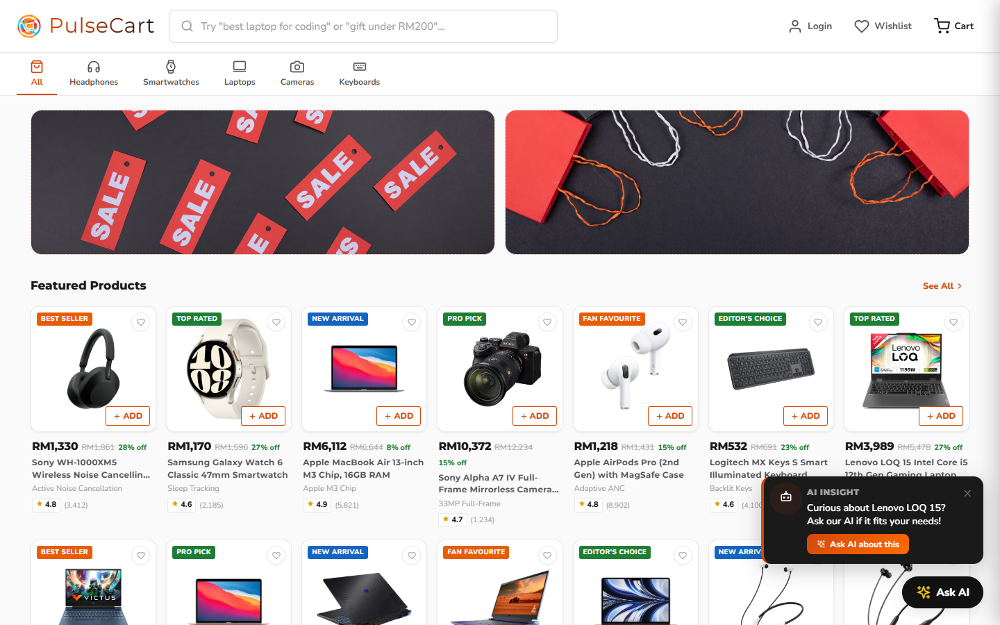
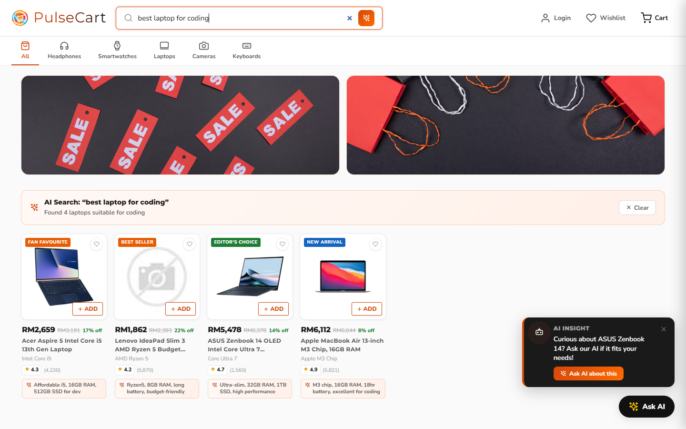
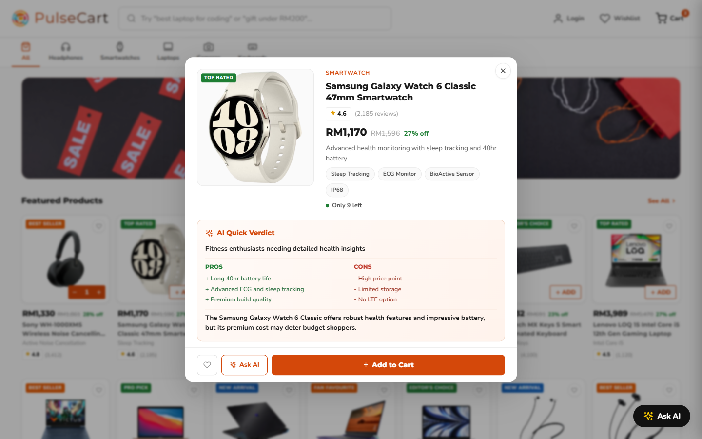
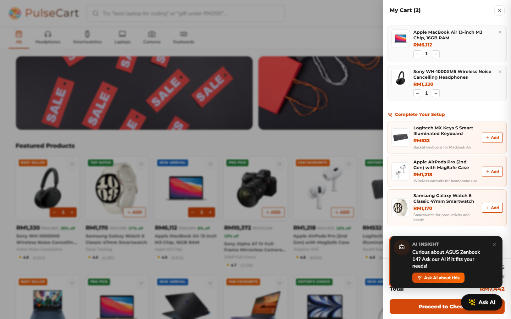
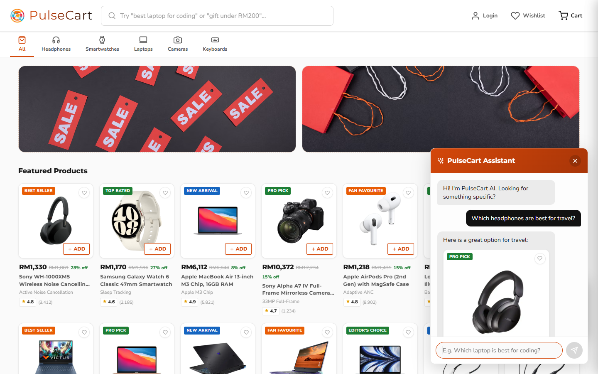
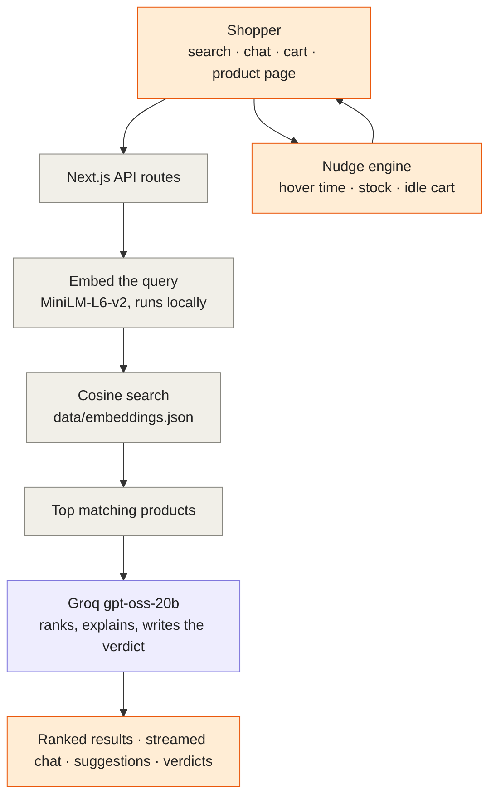

<div align="center">


<a href="#screenshots"></a>

<br/>

[](https://nextjs.org)
[](https://react.dev)
[](https://groq.com)
[](https://huggingface.co/Xenova/all-MiniLM-L6-v2)
[](#license)

</div>

---

##  Project Overview

PulseCart AI is an e-commerce prototype that shows how AI can sit inside the shopping experience instead of beside it. A modern storefront is paired with an assistant that knows the catalog, a search box that understands intent, and a nudge engine that reacts to what the shopper is doing.

The assistant never has the whole catalog pasted into its prompt. Each question is embedded, matched against a local vector store, and only the closest products are handed to the model, so answers stay grounded in real items and prices.

### Key Features

-  **AI smart search**: queries like "best laptop for coding" or "gift under RM200" return ranked products, each with a one-line reason.
-  **Shopping assistant**: a streaming chat widget that recommends and compares products, with product cards shown inline.
-  **AI quick verdict**: every product page gets generated pros, cons, a best-for line and a recommendation.
-  **Smart cart suggestions**: "Complete Your Setup" proposes two or three complementary products with a short reason.
-  **Nudge engine**: detects hesitation on a product, low stock on wishlist items and abandoned carts, and offers an "Ask AI about this" shortcut.
-  **Storefront basics**: 45 products in five categories, category filters, wishlist, cart drawer and free delivery above RM265.

##  Screenshots

**Storefront**



**AI smart search**



**Product detail with AI quick verdict**



**Cart with suggestions**



**AI shopping assistant**



##  Requirements

- Node.js 20 or newer
- A free [Groq API key](https://console.groq.com)

##  Quick Start

```bash
git clone https://github.com/mukesh-dev-git/PulseCartAI.git
cd PulseCartAI
npm install

# Add your Groq key
echo "GROQ_API_KEY=your_key_here" > .env.local

# Build the vector store (only needed again if data/products.json changes)
npm run embed

npm run dev
```

Open http://localhost:3000.

##  How It Works



### API

| Method | Endpoint | Description |
|---|---|---|
| POST | `/api/chat` | Streams the assistant's reply to a conversation |
| POST | `/api/search` | Ranked product ids with a reason for each match |
| POST | `/api/suggest` | Complementary products for the current cart |
| POST | `/api/verdict` | Pros, cons, best-for and recommendation for one product |

##  Project Structure

```
PulseCartAI/
├── app/
│   ├── page.js                # storefront
│   ├── api/                   # chat, search, suggest, verdict routes
│   └── components/            # chat widget, nudge engine, toasts, icons
├── lib/
│   ├── embeddings.js          # local embedding model wrapper
│   └── retrieval.js           # cosine search over the vector store
├── scripts/build-embeddings.mjs
├── data/
│   ├── products.json          # catalog, 45 items
│   └── embeddings.json        # precomputed vectors
├── docs/screenshots/
├── DOCUMENTATION.md           # deeper write-up
└── PLAN.md
```

##  Deployment

The app deploys to Vercel as a standard Next.js project with `GROQ_API_KEY` set as an environment variable. The original Vercel deployment has been taken down, so it runs locally for now.

##  License

MIT

##  Acknowledgments

- [Groq](https://groq.com) for fast inference
- [Transformers.js](https://huggingface.co/docs/transformers.js) and the `Xenova/all-MiniLM-L6-v2` model for local embeddings
- Built with Next.js and React

<div align="center">


</div>
